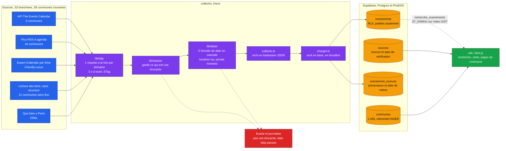

# brocantes

<!-- adam-badges:start -->
[](CHANGELOG.md)
[](https://github.com/Adam-Blf/brocantes/commits)
[](https://hits.sh/github.com/Adam-Blf/brocantes/)
[](https://github.com/Adam-Blf/brocantes/commits)
[](https://github.com/Adam-Blf/brocantes)
[](LICENSE)
<!-- adam-badges:end -->

Recense les brocantes et vide-greniers autour de chez vous, en Val-de-Marne et
a Paris. Une seule question, une reponse en moins de cinq secondes : qu'est-ce
qu'il y a ce week-end a moins de vingt kilometres, et comment j'y vais.

Etat en version 0.3.1 : jalons 1 a 3 livres. La chaine de collecte tourne
chaque jour et ecrit du reel, **18 evenements publies** au 11/09/2026, issus de
11 sources, sur 33 sources branchees et 28 communes couvertes. Le site Next.js
porte la recherche par position ou par commune, la liste et la carte
synchronisees, la fiche evenement et 28 pages de commune prerendues.

## Ce qu'il faut savoir avant de lire le code

**Il n'existe pas de source ouverte de brocantes en Ile-de-France.** C'est le
fait central du projet, et il a ete mesure, pas suppose. DATAtourisme porte une
categorie dediee aux vide-greniers, remplie en Occitanie avec 168 entrees, et
vide en Ile-de-France sur les 10 670 points d'interet de son export regional.
La recherche nationale sur data.gouv.fr ne rend aucun jeu de donnees. Les
portails departementaux du 92, 93, 94, 91, 77, 78 et 95 n'en portent aucun. Le
detail des mesures est dans [docs/SOURCES.md](docs/SOURCES.md).

**Les deux agregateurs prives du secteur sont fermes.** Leurs conditions
interdisent textuellement de "copier ou aspirer" leur contenu, et la Cour de
cassation a tranche contre le reutilisateur le 15 octobre 2025 dans un cas tres
proche. Ce depot ne les touche pas.

**La donnee vient donc des mairies elles-memes.** Un agenda municipal publie est
une information publique au sens de l'article L321-1 du code des relations entre
le public et l'administration, librement reutilisable. Les clauses de mentions
legales que presque toutes les communes affichent ne sont pas des licences
homologuees au sens de l'article L323-2, et sont donc sans effet sur ce droit.
Les obligations reelles tiennent en trois points, appliques ici : ne pas alterer
l'information, ne pas la denaturer, citer la source et la date du dernier
releve.

## Architecture



Le collecteur ne parle jamais au site, et le site ne parle jamais aux mairies.
Les deux ne partagent que le schema. La collecte n'a besoin d'aucun droit
d'ecriture, ce qui la rend rejouable sans secret.

## Sources branchees

| Famille | Communes | Ce qu'elle lit |
|---|---|---|
| `tribe` | Valenton, La Queue-en-Brie, Noiseau | API JSON du plugin The Events Calendar. La source la plus propre : dates structurees, adresse, code postal. |
| `rss` | 16 communes du 94 | Flux RSS. Cinq encodages de date differents, d'ou la cascade de `lib/dates.ts`. |
| `ics-wp` | Chevilly-Larue | Pas de flux global, mais un export iCalendar par fiche. |
| `html` | 12 communes du 94 | Ni flux ni API, et c'est justement la que sont les brocantes. Lecture des liens de la page agenda, sans supposer aucune structure de site. |
| `opendata-paris` | Paris | Jeu "Que faire a Paris", ODbL, mis a jour quotidiennement. |

### Pourquoi la famille `html` ne parse aucune structure

Les douze communes concernees tournent sur cinq moteurs differents, WordPress,
TYPO3, Drupal, Joomla et un CMS proprietaire. Un parseur par structure de page
serait douze fois du code casse au premier changement de theme. Le collecteur
releve donc les liens de la page, garde ceux dont le texte evoque une brocante,
et va lire la date sur la fiche. Un site peut changer entierement d'apparence
sans rien casser, tant qu'il continue de nommer ses evenements en francais.

## Installation

Prerequis : Node 20.12 ou plus pour le site, Deno 2 pour le collecteur, un
projet Supabase avec les migrations de `supabase/migrations/` appliquees.

```bash
cp .env.example .env.local          # puis remplir
npm install
npm run dev                         # site sur http://localhost:3000
npm test                            # tests unitaires (Vitest)
npm run test:e2e                    # parcours de bout en bout (Playwright)
deno check collector/collecte.ts    # verification des types du collecteur
```

### Variables d'environnement

| Variable | Usage |
|---|---|
| `BROCANTES_SUPABASE_URL`, `SUPABASE_PUBLISHABLE_KEY` | Projet Supabase, cote collecteur et garde RLS. Cle publique, protegee par la RLS. |
| `NEXT_PUBLIC_BROCANTES_SUPABASE_URL`, `NEXT_PUBLIC_SUPABASE_PUBLISHABLE_KEY` | Memes valeurs, lues par le site dans le navigateur. |
| `SUPABASE_SERVICE_KEY` | Vrai secret, contourne la RLS. Utilise seulement par `collector/charger.ts`. |
| `BROCANTES_RESEND_API_KEY`, `COURRIEL_EXPEDITEUR` | Envoi des alertes par courriel. |
| `URL_PUBLIQUE` | Adresse publique du service, reprise dans le user-agent du collecteur. |
| `CENTRAL_ENV_FILE` | Facultatif, chemin du fichier de secrets central en local. |

Les cles partagees avec d'autres projets portent le prefixe `BROCANTES`
(`BROCANTES_SUPABASE_URL`, `NEXT_PUBLIC_BROCANTES_SUPABASE_URL`), pour que chaque
nom soit unique sur tous les projets. En local, `next.config.ts` (via
`process.loadEnvFile`, Node 20.12+) et le collecteur (`collector/lib/env-central.ts`)
chargent aussi `~/.secrets/projets.env` s'il existe, chemin surchargeable par
`CENTRAL_ENV_FILE`. Une variable deja definie l'emporte, et en CI comme sur Vercel
le fichier est absent, donc rien ne change. Le collecteur ne le lit que s'il a
`--allow-read`.

Le referentiel des communes se charge une fois, depuis `geo.api.gouv.fr`, en une
requete par departement. Jamais commune par commune : 1 266 requetes pour un
fichier qui se telecharge d'un bloc serait un gaspillage et une impolitesse.

## Commandes

```bash
# Collecte complete. Les domaines sont listes un par un : un domaine absent est
# un domaine inaccessible, ce qui a deja evite deux redirections non prevues.
deno run --allow-net=<domaines> --allow-read --allow-write collector/collecte.ts

# Rejouer une seule source, pour corriger un collecteur sans resolliciter
# les vingt autres sites.
deno run --allow-net=<domaine> --allow-read --allow-write \
  collector/collecte.ts --source=cachan-rss

# Charger en base. Tout arrive en brouillon, rien n'est publie automatiquement.
deno run --allow-net --allow-env --allow-read collector/charger.ts <fichier.json>

# Garde RLS : verifie ce que la cle publique peut reellement atteindre.
deno run --allow-net=<hote> --allow-env tests/rls.ts
```

## La garde RLS

`tests/rls.ts` interroge l'API exactement comme le ferait un visiteur curieux,
et echoue si une table qui doit rester fermee repond quoi que ce soit. Sept
controles : lecture d'un evenement publie, non-fuite d'un brouillon, fermeture
des tables `contributions` et `alertes` qui portent des donnees personnelles,
refus d'une ecriture anonyme, absence de brouillon dans la fonction publiee,
bornage du rayon et de la limite.

Deux temoins vivent en base sous le prefixe `zzz-controle`, dates en 2099 pour
ne jamais croiser une recherche reelle. Sans eux, "la table ne renvoie rien"
passerait au vert sur une table vide, ce qui ne prouverait rien.

La garde a ete vue en rouge : en ouvrant volontairement deux politiques, elle
signale trois echecs et sort en code 1.

## Ce que le projet ne fait pas

Pas de collecte sur brocabrac ni vide-greniers.org. Pas de publication
automatique : un evenement dont la date a ete deduite plutot que declaree peut
envoyer quelqu'un devant une salle fermee. Pas de page de commune sans source
branchee : generer 1 266 pages dont 1 245 vides serait mauvais pour le
referencement et malhonnete pour le lecteur.

## Suite

Les jalons 2 et 3, l'interface puis les pages de commune et le referencement,
sont livres en 0.3.0. Jalon 4, declaration par les organisateurs, moderation, alerte hebdomadaire.
Jalon 5, mentions legales et politique de confidentialite, avec passage par
l'agent juridique avant toute mise en ligne.

## Un piege qui a coute une heure

Sous Windows, `rm -rf .next` echoue **en silence** quand le serveur Next tient
encore des fichiers ouverts, et `pkill -f next-server` ne trouve rien parce que
le processus s'appelle `node`. Le serveur continue alors de servir des
fragments de code perimes, en erreur 500 avec un type MIME `text/plain`, et des
pages mises en cache avant la derniere modification des donnees.

Les symptomes ne designent jamais la cause : une carte vide sans la moindre
erreur, un composant bloque sur son message de chargement, une page qui affiche
un evenement supprime de la base une heure plus tot. J'ai successivement
soupconne le style vectoriel de l'IGN, la politique de securite et la taille du
conteneur avant de trouver.

**Le geste juste** : arreter le serveur par son port, jamais par son nom, puis
`npm run rebuild`, qui echoue bruyamment si la suppression est incomplete au
lieu de laisser croire qu'elle a eu lieu.

```bash
# Arreter ce qui tient le port 3000, puis reconstruire proprement
npm run rebuild && npm run start
```

## Licence

Code sous licence MIT, voir [LICENSE](LICENSE). Les donnees collectees restent
sous le regime de leur source, publie source par source dans
[docs/SOURCES.md](docs/SOURCES.md) : information publique des communes, et ODbL
pour "Que faire a Paris".
